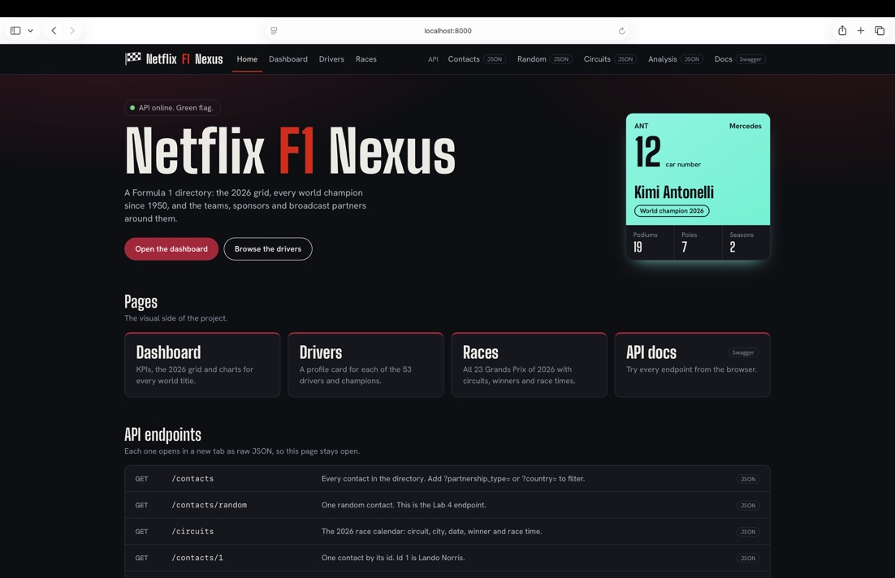
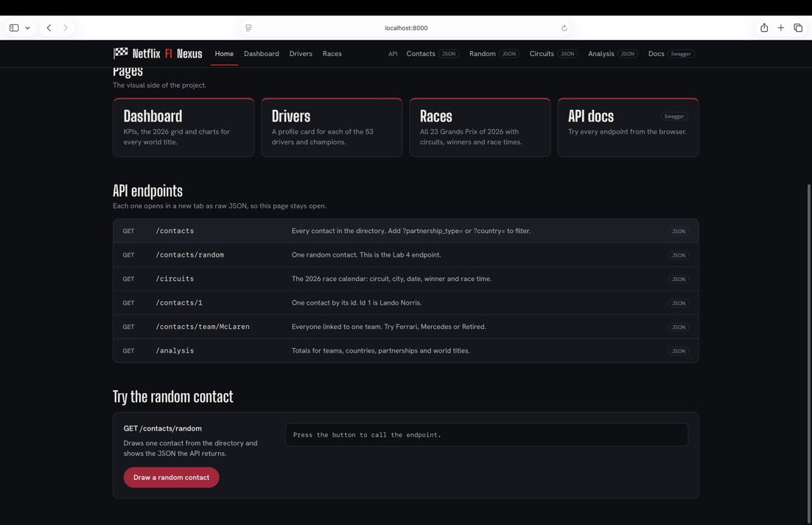
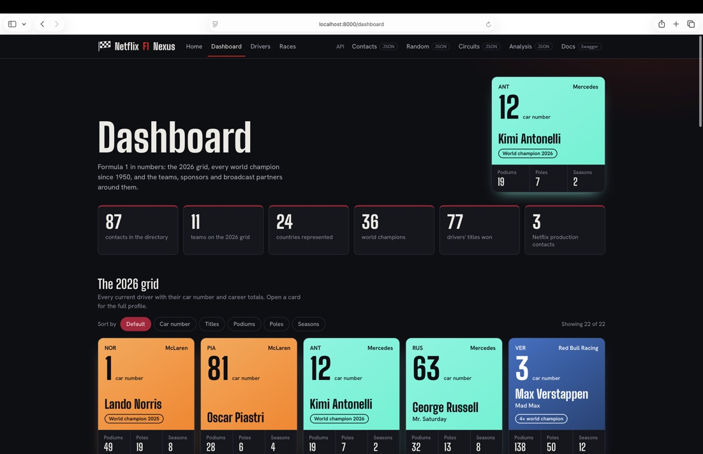
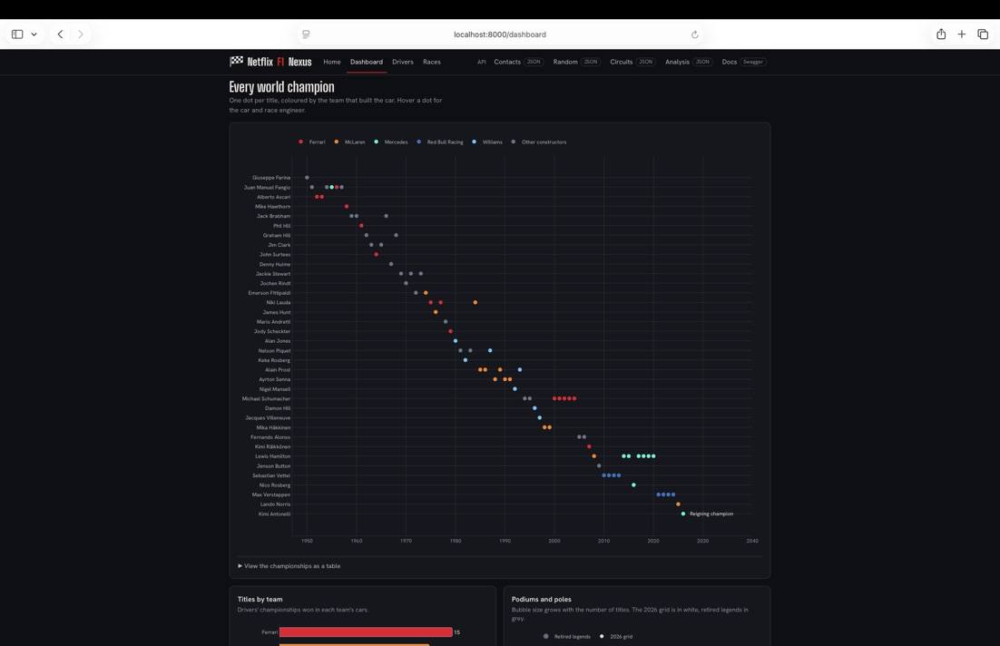
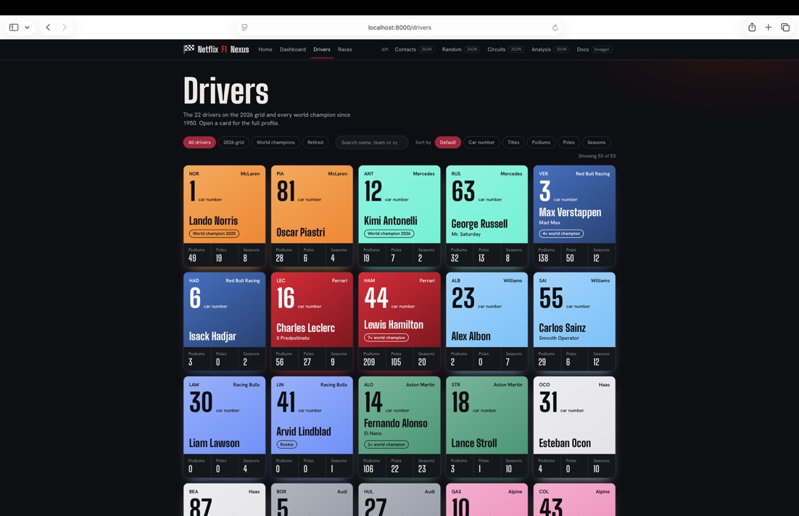
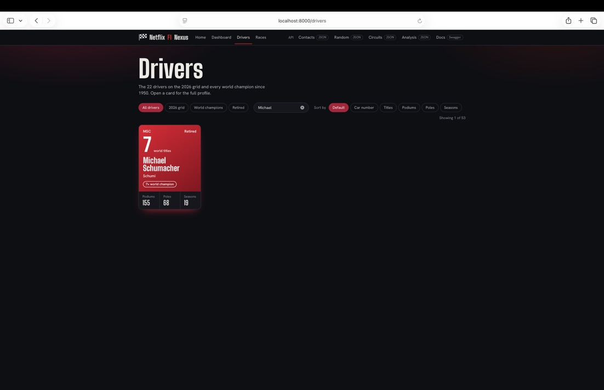
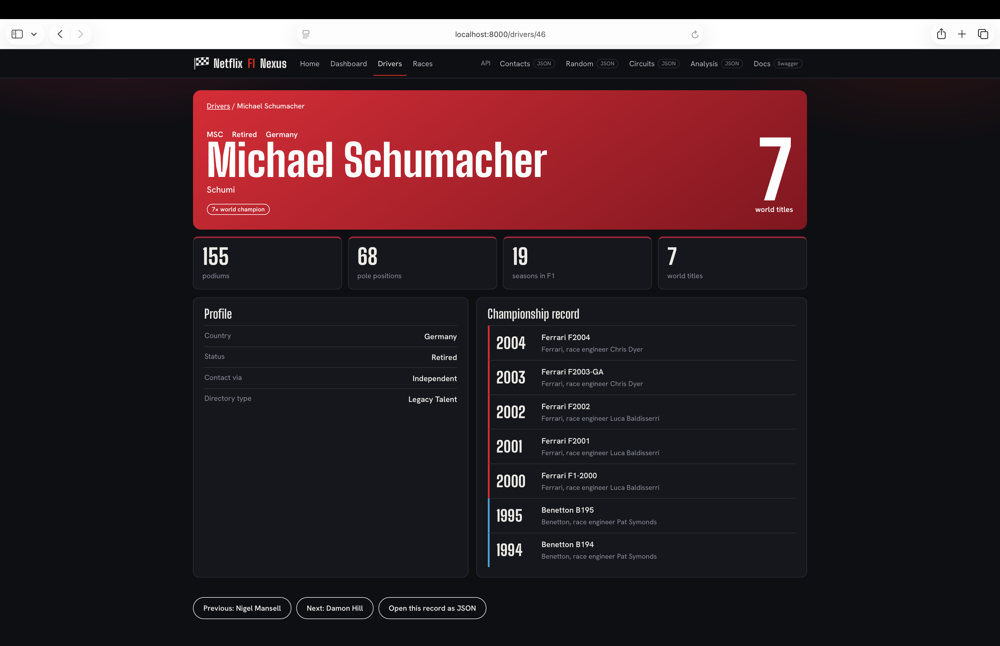
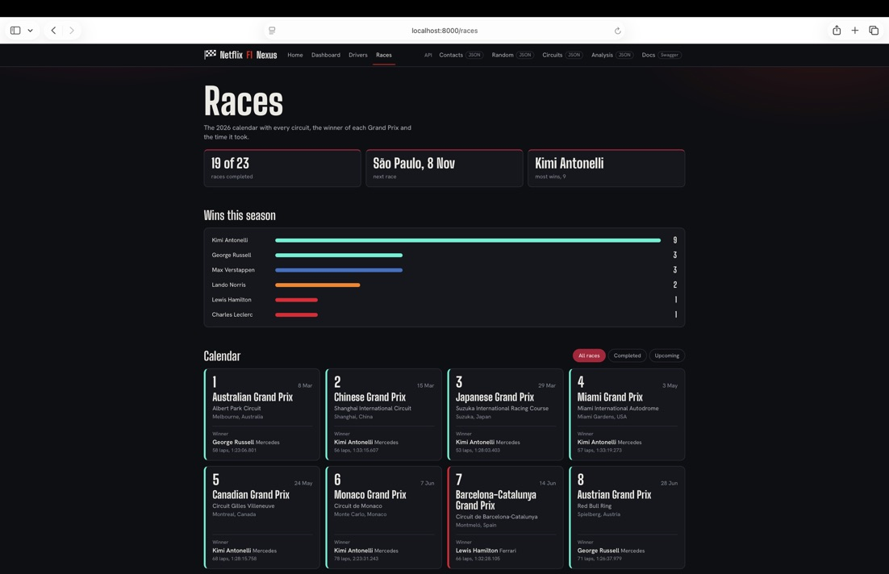

# Netflix F1 Nexus API

A Formula 1 contact directory built with FastAPI, pandas and Plotly. It covers the 2026 grid, every world champion since 1950, team leadership, sponsors and broadcast partners (including Netflix), plus the 2026 Grand Prix calendar.

Built for COMP-321 - Enterprise Systems Integration, Lab 4.

## Screenshots

### Home



### Dashboard




### Drivers



### Driver profile


### Races


## Features

- Team-coloured driver cards with car number, driver code, titles, podiums, poles and seasons
- Profile page for every driver and champion, with each title's car, team and race engineer
- Dashboard with KPIs, the 2026 grid and interactive Plotly charts
- Races page with all 23 Grands Prix of 2026, circuits, winners and race times
- Top navigation on every page, with API links that open in a new tab
- Random contact endpoint for the lab requirement
- Rate limiting, trusted hosts, CORS rules and input checks on path parameters

## Pages

| Route | What it shows |
|---|---|
| `/` | Home page in a browser, health JSON for Postman and code |
| `/dashboard` | KPIs, the 2026 grid and charts |
| `/drivers` | Cards for all 53 drivers and champions, with filter, search and sort |
| `/drivers/{id}` | Profile of one driver or champion |
| `/races` | The 2026 calendar with winners |
| `/docs` | Swagger UI |

## API endpoints

| Method | Route | Description |
|---|---|---|
| GET | `/contacts` | All contacts. Filter with `?partnership_type=` or `?country=` |
| GET | `/contacts/random` | One random contact |
| GET | `/contacts/{id}` | One contact by id |
| GET | `/contacts/team/{team_name}` | Everyone linked to a team, such as `McLaren` or `Retired` |
| GET | `/circuits` | The 2026 race calendar as JSON |
| GET | `/analysis` | Totals for teams, countries, partnerships and world titles |

Example response from `/contacts/random`:

```json
{
  "id": 8,
  "contact_name": "Lewis Hamilton",
  "company": "Scuderia Ferrari HP",
  "f1_team": "Ferrari",
  "car_number": 44
}
```

## Project structure

```
netflix-f1-nexus-api/
├── main.py                  # FastAPI app, routes, middleware, data loading
├── ui_kit.py                # Shared page shell, navigation, driver cards, colours
├── pages.py                 # Home, drivers, driver profile and races pages
├── dashboard.py             # Dashboard page and Plotly charts
├── f1_nexus_contacts.csv    # 87 contacts
├── f1_nexus_races.csv       # 2026 Grand Prix calendar and results
├── docs/screenshots/        # Images used in this README
└── test_main.http           # Requests for the PyCharm HTTP client
```

## Data

- Drivers, car numbers, cars, race engineers and career totals for the 2026 grid, checked against F1.com
- World champions with title years, title cars, title teams and race engineers
- Race winners and times from F1.com results
- Empty cells in the CSV are intentional and come back as `null` in the JSON

## Roadmap

- Deploy to Railway or Render
- MongoDB Atlas storage
- AI-written driver bios
- React frontend